* Table of Contents
{:toc}

--------------------------------------------------------------------------------------------------------------------

## **Acknowledgements**

* [AddressBook Level 3 by SE-EDU](https://github.com/se-edu/addressbook-level3): the application foundation, test utilities, documentation structure and original architecture diagrams. Roster adapts this code for tutorial attendance management.
* [OpenJFX](https://openjfx.io/) for the desktop interface and observable collections; [Jackson](https://github.com/FasterXML/jackson) for JSON storage.
* [JUnit 5](https://junit.org/junit5/), [JaCoCo](https://www.jacoco.org/jacoco/) and [Checkstyle](https://checkstyle.org/) for testing, coverage and coding-style checks.
* [Gradle](https://gradle.org/) and [Shadow](https://gradleup.com/shadow/) for building the application and packaged JAR; [PlantUML](https://plantuml.com/) for UML diagrams.

--------------------------------------------------------------------------------------------------------------------

## **Setting up, getting started**

Refer to the guide [_Setting up and getting started_](SettingUp.md).

--------------------------------------------------------------------------------------------------------------------

## **Design**

<div markdown="span" class="alert alert-primary">

:bulb: **Tip:** The `.puml` files used to create diagrams are in `docs/diagrams`. Refer to the [_PlantUML Tutorial_ at se-edu/guides](https://se-education.org/guides/tutorials/plantUml.html) to learn how to create and edit diagrams.
</div>

### Architecture


The ***Architecture Diagram*** given above explains the high-level design of the App.

The following provides a quick overview of the main components and their interactions.

**Main components of the architecture**

**`Main`** (consisting of classes [`Main`](https://github.com/AY2627S1-CS2103T-F12-4/tp/blob/master/src/main/java/seedu/address/Main.java) and [`MainApp`](https://github.com/AY2627S1-CS2103T-F12-4/tp/blob/master/src/main/java/seedu/address/MainApp.java)) is in charge of the app launch and shut down.
* At app launch, it initializes the other components in the correct sequence, and connects them up with each other.
* At shut down, it shuts down the other components and invokes cleanup methods where necessary.

The bulk of the app's work is done by the following four components:

* [**`UI`**](#ui-component): The UI of the App.
* [**`Logic`**](#logic-component): The command executor.
* [**`Model`**](#model-component): Holds the data of the App in memory.
* [**`Storage`**](#storage-component): Reads data from, and writes data to, the hard disk.

[**`Commons`**](#common-classes) represents a collection of classes used by multiple other components.

**How the architecture components interact with each other**

The *Sequence Diagram* below shows how the components interact with each other for the scenario where the user issues the command `delete 1`.

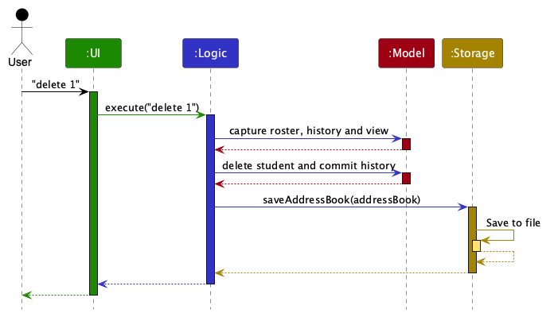

Each of the four main components (also shown in the diagram above),

* defines its *API* in an `interface` with the same name as the Component.
* provides its functionality through a concrete `{Component Name}Manager` class that implements the corresponding API interface.

For example, the `Logic` component defines its API in `Logic.java` and implements it in `LogicManager.java`. Other components interact with a component through its interface rather than its concrete class, preventing them from coupling to that component's implementation, as illustrated in the following partial class diagram.


The sections below give more details of each component.

### UI component

The **API** of this component is specified in [`Ui.java`](https://github.com/AY2627S1-CS2103T-F12-4/tp/blob/master/src/main/java/seedu/address/ui/Ui.java)

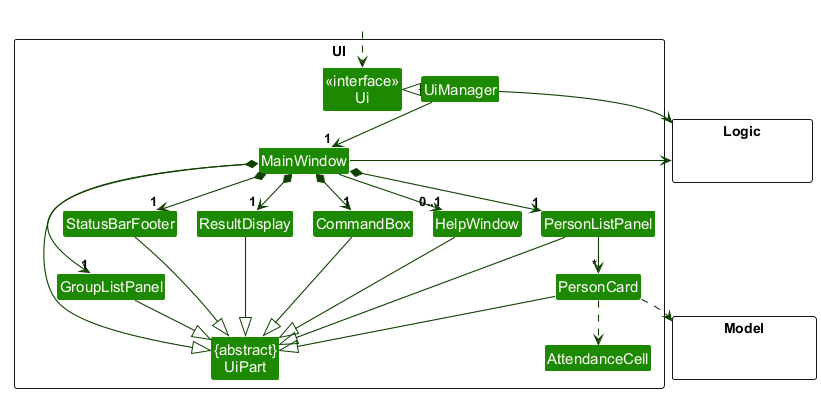

The UI consists of a `MainWindow` and its parts, such as `CommandBox`, `ResultDisplay`, `GroupListPanel`, `PersonListPanel`, and `StatusBarFooter`. All of these, including `MainWindow`, inherit from the abstract `UiPart` class, which captures common behavior among classes that represent visible GUI parts.

* `GroupListPanel` lists **All students** and registered groups in a horizontal strip. Choosing an entry
  runs the matching `list` command. Up/Down are retained as aliases for horizontal selection, and Enter
  opens the selected view without replacing unfinished command text.
* `PersonListPanel` binds the displayed-student count and shows one `PersonCard` per displayed student.
  Card width follows the list cell's available width; the attendance flow measures height using its
  current width, so all teaching weeks wrap instead of causing horizontal overflow or oversized rows.
  Comments remain visible below the row's details, and long tags have tooltips.
* `CommandBox` suggests command words, prefixes and values using `FieldCompletion`. Its border and
  `ResultDisplay`'s banner receive consistent success/error state from `MainWindow`, including commands
  invoked through navigation and undo shortcuts. Changing the input clears its previous highlight.

The `UI` component uses the JavaFX UI framework. The layouts of these UI parts are defined in matching `.fxml` files in `src/main/resources/view`. For example, [`MainWindow.fxml`](https://github.com/AY2627S1-CS2103T-F12-4/tp/blob/master/src/main/resources/view/MainWindow.fxml) specifies the layout of [`MainWindow`](https://github.com/AY2627S1-CS2103T-F12-4/tp/blob/master/src/main/java/seedu/address/ui/MainWindow.java).

The `UI` component,

* executes user commands using the `Logic` component.
* listens for changes to `Model` data so that the UI can be updated with the modified data.
* keeps a reference to the `Logic` component, because the `UI` relies on the `Logic` to execute commands.
* depends on some classes in the `Model` component because it displays `Person` objects from the model.

### Logic component

**API** : [`Logic.java`](https://github.com/AY2627S1-CS2103T-F12-4/tp/blob/master/src/main/java/seedu/address/logic/Logic.java)

Here's a (partial) class diagram of the `Logic` component:


The sequence diagram below illustrates the interactions within the `Logic` component, taking `execute("delete 1")` API call as an example.


<div markdown="span" class="alert alert-info">:information_source: **Note:** The lifeline for `DeleteCommandParser` should end at the destroy marker (X), but due to a limitation of PlantUML, it continues to the end of the diagram.
</div>

How the `Logic` component works:

1. When `Logic` is called upon to execute a command, the command is passed to an `AddressBookParser` object, which in turn creates a parser that matches the command (e.g., `DeleteCommandParser`) and uses it to parse the command.
1. This results in a `Command` object (more precisely, an object of one of its subclasses e.g., `DeleteCommand`) which is executed by the `LogicManager`.
1. The command can communicate with the `Model` when it is executed (e.g. to delete a person).<br>
   Note that although this is shown as a single step in the diagram above for simplicity, the code can require several interactions between the command object and the `Model` to complete the operation.
1. The result of the command execution is encapsulated as a `CommandResult` object which is returned from `Logic`.

Here are the other classes in `Logic` (omitted from the class diagram above) that are used for parsing a user command:


How the parsing works:
* When called upon to parse a user command, the `AddressBookParser` class creates an `XYZCommandParser` (`XYZ` is a placeholder for the specific command name, e.g., `AddCommandParser`). The parser uses the other classes shown above to parse the user command and create an `XYZCommand` object (e.g., `AddCommand`). The `AddressBookParser` returns that object as a `Command` object.
* All `XYZCommandParser` classes, such as `AddCommandParser` and `DeleteCommandParser`, implement the `Parser` interface so they can be treated similarly where appropriate, for example during testing.

### Model component
**API** : [`Model.java`](https://github.com/AY2627S1-CS2103T-F12-4/tp/blob/master/src/main/java/seedu/address/model/Model.java)

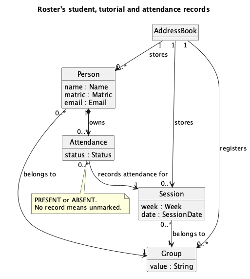


The `Model` component,

* stores student records (`Person`) in `UniquePersonList`, registered tutorial groups, and sessions in `UniqueSessionList`, all owned by `AddressBook`.
* applies a `FilteredList` to the complete roster and wraps it in a `SortedList` ordered by matriculation number. These views stay backed by the roster; they do not copy student records. The UI observes the displayed list and the active-group property.
* stores a `UserPrefs` object that represents the user’s preferences (currently, just the GUI settings). This is exposed to the outside as a `ReadOnlyUserPrefs` object.
* does not depend on any of the other three components (as the `Model` represents data entities of the domain, they should make sense on their own without depending on other components)

A student belongs to one group. A session is identified by its group and teaching week. Each student
owns at most one attendance record per session of their group; no record means unmarked. Group and
session identity are compared by value, so the diagram does not imply that each value has a single
shared Java object. For clarity, the diagram shows a student's comment and tags as attributes and omits the
collection-wrapper classes, such as `UniquePersonList`.

`Person` is immutable. A command that changes a student, such as `mark` or `comment`, creates an updated copy
(for example with `Person#withAttendance`) and replaces the original through `Model#setPerson`.

### Storage component

**API** : [`Storage.java`](https://github.com/AY2627S1-CS2103T-F12-4/tp/blob/master/src/main/java/seedu/address/storage/Storage.java)

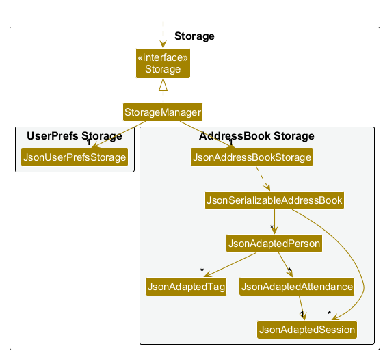

The `Storage` component,
* can save both address book data and user preference data in JSON format, and read them back into corresponding objects.
* is implemented by `StorageManager`, which delegates the actual JSON file access to `JsonAddressBookStorage` and `JsonUserPrefsStorage` (one class per data file).
* saves the registered group codes, the sessions (`JsonAdaptedSession`) and the students (`JsonAdaptedPerson`). Each student's attendance records (`JsonAdaptedAttendance`) name the session they belong to.
* rejects a data file whose records are inconsistent, such as duplicate students or attendance for a session that does not exist. Roster then starts with an empty roster rather than with partly loaded data.
* also holds `CsvAttendanceExporter` and `CsvFileAccess`, which the `export` command uses to write CSV reports inside Roster's home folder.
* depends on some classes in the `Model` component (because the `Storage` component's job is to save/retrieve objects that belong to the `Model`)

### Common classes

Classes used by multiple components are in the `seedu.address.commons` package.

--------------------------------------------------------------------------------------------------------------------

## **Implementation**

This section describes some noteworthy details on how certain features are implemented.

### Filtered student search

`FindCommandParser` accepts optional `n/`, `m/` and `grp/` filters, rejects duplicate or empty fields,
and uses the shared parsing utilities to normalize matriculation numbers and group codes.
`StudentMatchesFiltersPredicate` combines the supplied conditions using AND. It delegates name matching
to `NameContainsQueryPredicate`, so future changes to the shared name matcher also apply to filtered search.
The matcher uses a quoted literal regular expression with Unicode case-insensitive matching, avoiding
context-dependent lowercasing errors such as Greek final sigma. Accents and punctuation remain significant.

`FindCommand` checks that an explicitly requested group is registered before changing the view.
`ModelManager` applies the predicate to the full roster and exposes the results in matriculation-number order.
The active group is cleared because even a group-filtered search may display only part of a group.
The observable list reflects additions and removals while the search predicate is active. A modifying
command can subsequently choose another view; its own command specification defines that behavior.

The sequence below follows `find n/John grp/T09` after parsing. An unknown group is rejected before
the model is updated. A valid search replaces the predicate and clears the active-group selection.

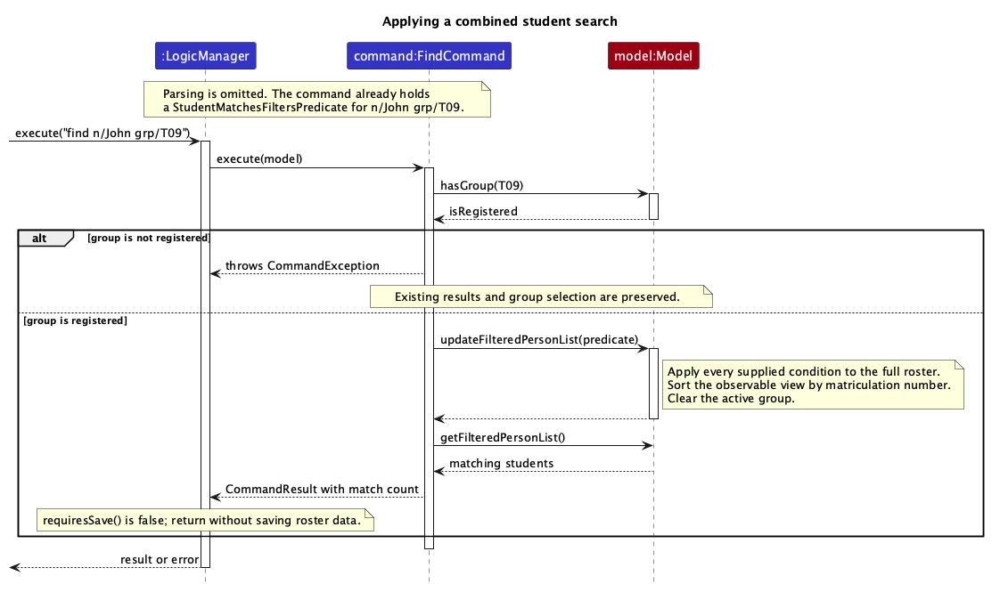

**Design choices**

* Search the full roster rather than the current view, so a search after an empty result can recover students.
* Combine fields with AND. Matriculation number and group are exact matches; names use a literal substring.
* Keep one observable view instead of copying results, so displayed indexes remain correct after add or delete.
* Assert the model's global-search contract and log match counts and rejected groups at `FINE` level.
  Exceptions handle invalid user input; assertions detect inconsistent internal model behavior.

`FindCommand.requiresSave()` returns false. `LogicManager` therefore returns the search result
without rewriting the roster file or copying the roster for undo history. Other read-only commands use the same
approach, while data-changing commands retain their existing save behaviour.
Assertions are enabled for Gradle tests and `./gradlew run`. When running a packaged JAR for testing,
use `java -ea -jar roster.jar`; enable VM option `-ea` in an IDE run configuration as well.

### Attendance CSV export

`ExportCommandParser` accepts a required `f/` destination and optional `grp/` scope. The shared
`CsvFileArgumentsParser` performs a quote-aware parameter scan that preserves spaces and prefix-like
directory names inside quoted paths.
`ExportCommand` validates the requested group and passes the full roster to `CsvAttendanceExporter`,
independently of the current displayed list.

The exporter writes UTF-8 rows ordered by matriculation number and session week, using the fixed
`matric,name,email,group,week,date,attendance` header. Missing attendance for an existing session becomes
`unmarked`; students without sessions receive a row with empty session fields.
It first writes a temporary sibling file, then moves the completed file to its destination without
replacing existing files. A finally block removes temporary output on both success and failure.

The activity diagram shows the validation and publication paths. Failures during temporary-file
creation, writing or publication are reported to the caller; cleanup runs when a temporary file exists.

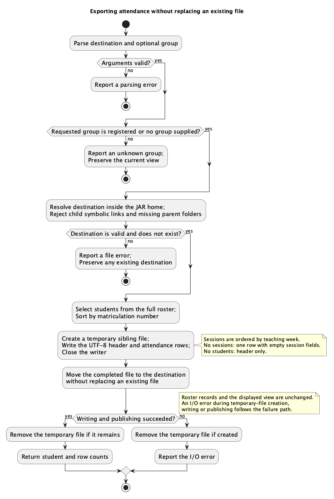

**Design choices**

* Export the full roster or an explicit group instead of the displayed search results, avoiding incomplete reports.
* Write a temporary sibling before publication rather than writing the destination directly, so a failed write
  does not leave a partial report under the requested filename. Moving without replacement preserves existing files.
* Keep a fixed UTF-8 schema and deterministic ordering so coordinators can compare reports from different runs.
* Assert that summary counts are non-negative and contain at least one row per exported student.
  Command diagnostics distinguish unknown groups, existing destinations and unexpected file failures.

`Command.requiresSave()` defaults to true. Export and other read-only commands override it to false because they do
not change roster records. `LogicManager` therefore returns their results without saving or making an undo snapshot.

`CsvFileAccess` confines CSV output to the JAR's home folder (the working folder for development
runs). It resolves relative paths from this root and rejects outside paths and symbolic-link components
before writing a CSV. Directory aliases used by macOS are resolved against the canonical home folder.

### Marking attendance

`mark INDEX w/WEEK s/STATUS` records one displayed student as present or absent. `MarkCommandParser` checks the
index, week and status, and creates a `MarkCommand`. When the command executes, it:

1. finds the student at `INDEX` in the displayed list;
1. asks the `Model` for the session of **that student's own group** in the requested week;
1. creates an updated copy of the student with the new attendance record, since `Person` is immutable;
1. replaces the student through `Model#setPerson`. The displayed list updates itself, and its order and indexes
   stay the same, so the TA can carry on marking by index.

`LogicManager` then saves the roster and commits it to the undo history. The sequence diagram below shows
`mark 1 w/5 s/present`. For simplicity, it leaves out `MarkCommandParser`, which works as `DeleteCommandParser`
does in the [Logic component](#logic-component).

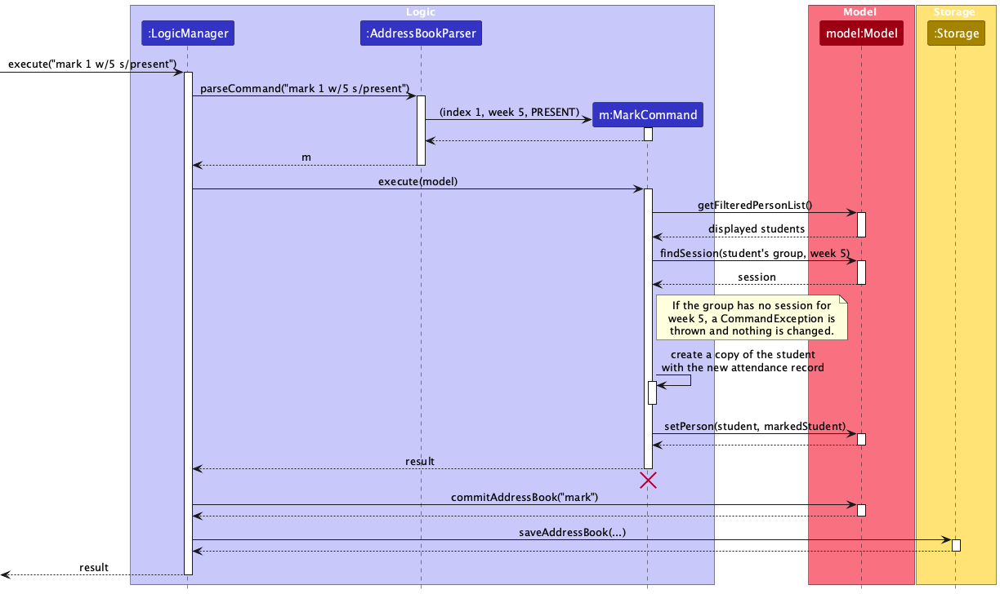

A student has at most one record per session. `Person#withAttendance` replaces an earlier record for the same
session, and `MarkCommand` includes the previous status in its message, so the TA can tell that a record was
overwritten.

**Marking every displayed student.** `mark all w/WEEK s/STATUS` is handled by `MarkAllCommand`. The displayed
list may span several groups, so it finds the week's session in every displayed student's group **before**
changing anything. If any group has no session for that week, the command fails and no student is marked.

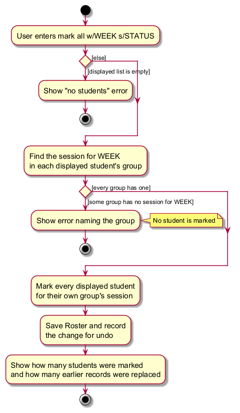

**Design considerations**

* **Aspect: which session a student is marked for**
  * **Alternative 1 (current choice):** use the session of each student's own group for the given week.
    * Pros: works on any displayed list, including search results that mix groups.
    * Cons: the same command can update sessions of several groups at once.
  * **Alternative 2:** use the session of the active group only.
    * Pros: simpler to explain.
    * Cons: fails, or marks the wrong session, whenever the displayed list is not a single group.
* **Aspect: what `mark all` does when some groups have no session**
  * **Alternative 1 (current choice):** check every group first, and mark nobody unless every group has a session.
    * Pros: a failed command changes nothing, as for every other command.
    * Cons: the TA must create the missing session before marking anyone.
  * **Alternative 2:** mark the students whose group has a session and skip the rest.
    * Pros: no extra step for the TA.
    * Cons: leaves attendance half recorded, which is easy to miss.

### Deleting displayed students

`delete INDEX` (`DeleteCommand`) and `delete all` (`DeleteAllCommand`) remove students through
`Model#deletePerson`. Attendance records are stored inside each `Person`, so they are removed with the student.
Tutorial groups and sessions are kept, even when a group becomes empty. `delete all` copies the displayed list
before deleting, because the list shrinks as students are removed. Both commands are undoable.

### Showing a newly added student

After adding a student, `AddCommand` checks whether the student is in the displayed list. If not, for example
because a different group is shown, it shows the student's group instead. It returns a `CommandResult` that names
the student to show, and `MainWindow` asks `PersonListPanel` to scroll to and highlight the student's card.

`PersonListPanel` cannot scroll accurately until the list has been laid out, because cards differ in height. It
therefore checks after each layout pass whether the card is fully visible and scrolls again if not, up to a fixed
number of attempts. The highlight is cleared by the next command, including one that fails.

### Student comments

`comment INDEX c/COMMENT` appends to a student's `Comment`, joining notes with `; `, while `c-/COMMENT` replaces it
and an empty `c-/` clears it. Only `c-/` discards existing text, so a note is never lost by accident. A comment is
limited to 200 characters, and an append that would exceed the limit is rejected without changing the comment.

### Field completion

`FieldCompletion` suggests command words, the prefixes the current command accepts, registered group codes after
`grp/`, attendance statuses after `s/`, and `all` for `mark` and `delete`. It only reads the command text and the
list of groups, and never executes or validates a command. `CommandBox` shows its suggestions in a pop-up list.
Each suggestion records the range of text it replaces, so accepting one leaves the rest of the command unchanged.

### Commenting on a student

The `comment` command attaches free-text remarks to a student, so that a tutor can record observations
about them over a semester. `CommentCommandParser` recognises two prefixes: `c/` adds to whatever comment
the student already has, while `c-/` replaces it, and `c-/` on its own clears it. Supplying both prefixes,
or `c/` with no text, is rejected during parsing rather than at execution.

`CommentCommand` resolves the index against the displayed student list and asks `Comment` for the length
of the combined text before making any change. An append that would exceed `Comment.MAX_LENGTH` is
rejected, leaving the student's existing comment untouched. The new comment is applied by building a
replacement immutable `Person` through `Person#withComment` and handing it to `Model#setPerson`.

The sequence below follows `comment 3 c/asks good questions` after parsing.

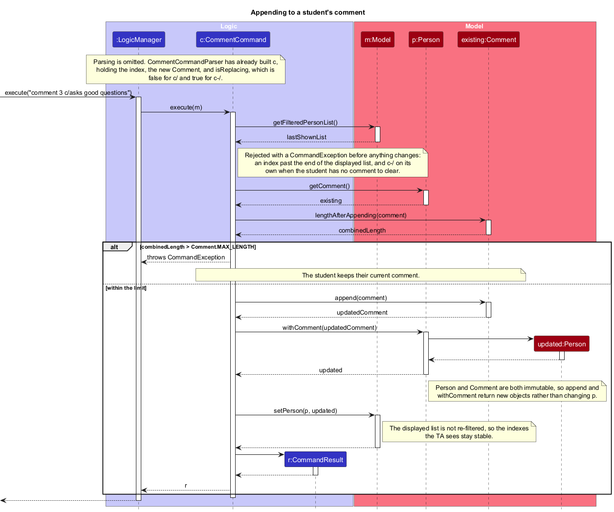

**Design choices**

* Check the combined length before appending rather than truncating, so a rejected comment never loses
  text the tutor has already recorded.
* Make `c-/` an explicit prefix rather than treating an empty `c/` as a clear, so that destroying an
  existing comment is always deliberate.
* Leave the displayed list unfiltered after the update, so the indexes the tutor is reading off the
  screen stay valid and several students can be commented on in succession.
* Store the comment as a single normalised string rather than a list of remarks. Comments are read by a
  person rather than queried, so the simpler field avoids storage and UI changes that nothing yet needs.

### Undo feature

The undo mechanism is facilitated by `VersionedAddressBook`. It extends `AddressBook` with a history of complete
Roster snapshots, stored internally as an `addressBookStateList` and `currentStatePointer`.

* `VersionedAddressBook#commit(String)` saves the current address book state and command name in its history.
* `VersionedAddressBook#undo()` restores the previous address book state from its history.
* `VersionedAddressBook#redo()` reapplies a state only when an unsuccessful save requires an undo to be rolled back.

These operations are exposed by `Model`. Roster does not provide a user-facing redo command.

When a successful data-changing command such as `add`, `delete`, or `clear` is saved, `LogicManager` calls
`Model#commitAddressBook()`. Read-only and failed commands do not change the history. The default history action
is derived from `Command#requiresSave()`, while special commands such as `undo` override it. This makes new
data-changing commands undoable unless they explicitly opt out.

For example, the user executes `add n/David …​`, causing the modified address book state to be saved into the
`addressBookStateList`.


<div markdown="span" class="alert alert-info">:information_source: **Note:** If a command fails its execution, it will not call `Model#commitAddressBook()`, so the address book state will not be saved into the `addressBookStateList`.

</div>

The user then decides that adding the person was a mistake and executes `undo`. `UndoCommand` calls
`Model#undoAddressBook()`, which shifts the `currentStatePointer` one position left and restores that snapshot.


<div markdown="span" class="alert alert-info">:information_source: **Note:** If the `currentStatePointer` is at index 0, pointing to the initial AddressBook state, then there are no previous AddressBook states to restore. The `undo` command uses `Model#canUndoAddressBook()` to check if this is the case. If so, it will return an error to the user rather
than attempting to perform the undo.

</div>

The following sequence diagram shows how an undo operation goes through the `Logic` component:

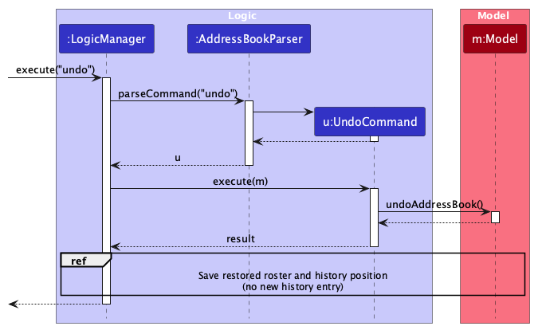

<div markdown="span" class="alert alert-info">:information_source: **Note:** The lifeline for `UndoCommand` should end at the destroy marker (X), but due to a limitation of PlantUML, it continues to the end of the diagram.

</div>

Similarly, how an undo operation goes through the `Model` component is shown below:

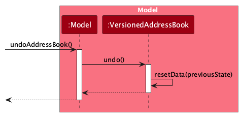

`Model#redoAddressBook()` is used internally only if saving an undo operation fails. It restores the later in-memory
state so that the model remains consistent with the data file.

<div markdown="span" class="alert alert-info">:information_source: **Note:** The internal redo operation is not exposed
to users.

</div>

The user then executes `list`. Read-only and failed commands do not change `addressBookStateList`.


The user executes `clear`, which commits the empty roster as another snapshot. A subsequent `undo` restores the
complete roster, including groups, sessions, students, and attendance records.


The following activity diagram summarizes what happens when a user executes a new command, including the
rollback when the data file cannot be saved:

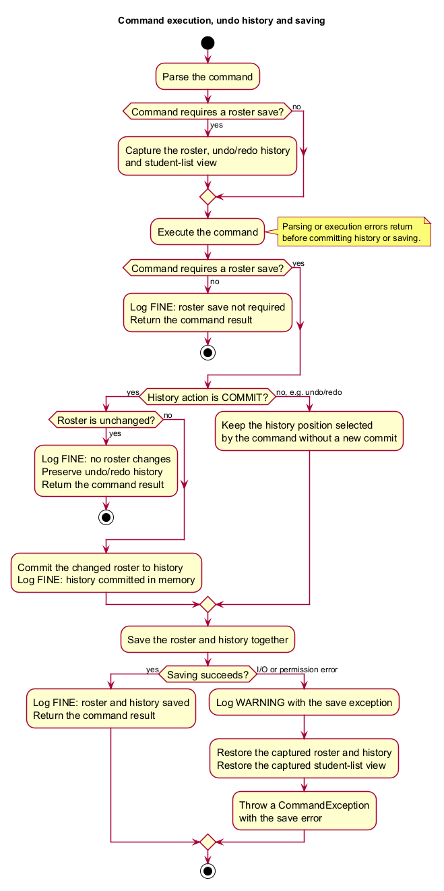

#### Design considerations:

**Aspect: How undo executes:**

* **Alternative 1 (current choice):** Saves the entire address book.
  * Pros: Easy to implement.
  * Cons: May have performance issues in terms of memory usage.

* **Alternative 2:** Each command knows how to undo itself.
  * Pros: Uses less memory for small changes.
  * Cons: We must ensure that the implementation of each individual command is correct.


--------------------------------------------------------------------------------------------------------------------

## **Documentation, logging, testing, dev-ops**

* [Documentation guide](Documentation.md)
* [Testing guide](Testing.md)
* [Logging guide](Logging.md)
* [DevOps guide](DevOps.md)

--------------------------------------------------------------------------------------------------------------------

## **Appendix: Requirements**

### Product scope

**Target user profile**:

* is an NUS teaching assistant who manages multiple tutorial groups from a laptop
* is new to being a TA: forgetful, disorganised, and has a lot on their mind
* struggles to manage several tutorial groups simultaneously
* has a technical background
* needs to take attendance, record participation, track assignment completion and review individual
  progress during tutorials
* needs to move between tutorial groups quickly, as routine actions must be fast and require little
  attention while teaching and interacting with students
* reviews the collected information after class to identify students who may need additional support
* prefers typing to mouse interactions and is reasonably comfortable using CLI apps

**Value proposition**: Maintain and review attendance, participation and assignment-completion records for
students across multiple tutorial groups in one contact-book-style application, with updates fast enough to
make during class — faster than managing spreadsheets or a typical mouse-driven GUI application.


### User stories

Priorities: High (must have) - `* * *`, Medium (nice to have) - `* *`, Low (unlikely to have) - `*`

| Priority | As a …​                                    | I want to …​                     | So that I can…​                                                        |
| -------- | ------------------------------------------ | ------------------------------ | ---------------------------------------------------------------------- |
| `* * *`  | new TA | create a new tutorial group | add students to it |
| `* * *`  | TA | add a student to a tutorial group | keep a record of everyone I am responsible for |
| `* * *`  | TA | delete a student from a tutorial group | remove a record entered with wrong details, or a student who dropped the module |
| `* * *`  | new TA | view my students | see who I am responsible for |
| `* * *`  | forgetful TA | search for a student by name | avoid having to remember which group contains the student |
| `* * *`  | TA | mark a student present or absent for a session | keep an accurate attendance record |
| `* * *`  | disorganised TA | distinguish unmarked attendance from confirmed absence | be sure missing records are not mistaken for absences |
| `* * *`  | TA | switch between tutorial groups | manage multiple classes without mixing up their records |
| `* * *`  | new TA| assign each student to exactly one tutorial group | keep students from different groups from being mixed together |
| `* * *`  | TA | view a student's attendance for every session of their tutorial group | understand the student's attendance pattern over time |
| `* *`    | TA | edit a student's information | keep their details up to date |
| `* *`    | new TA unfamiliar with the app | see the app pre-loaded with sample students and attendance records | know what the data should look like before entering my own |
| `* *`    | new TA | remove all sample data | start with a clean record |
| `* *`    | cautious TA just starting out | get a warning before permanently deleting a student | avoid losing data from an accidental keystroke |
| `* *`    | new TA | record whether a student has completed an assignment | monitor assignment progress |
| `* *`    | TA who occasionally mistypes a command | undo my last action | avoid redoing work after a small mistake |
| `* *`    | TA | move a student to another tutorial group | keep group changes accurate when a student swaps groups |
| `* *`    | TA | mark attendance for an entire tutorial group in one action | spend less time recording attendance |
| `* *`    | experienced TA | find a student by matriculation number | find the right student even when two students share a name |
| `* *`    | experienced TA | mark a student's attendance by matriculation number | avoid marking the wrong student after the displayed list is filtered |
| `* *`    | experienced TA | identify students with incomplete assignments | follow up on students who may be falling behind |
| `* *`    | experienced TA | view a summary of a tutorial group's attendance | identify general trends and students who may need support |
| `* *`    | experienced TA | export students' attendance records | share or analyse the records outside the app |
| `* *`    | experienced TA | export attendance with the columns my course coordinator specifies | load the file into the gradebook without editing it first |
| `* *`    | experienced TA | export attendance keyed by matriculation number | match rows to the official roster even when names are recorded differently |
| `*`      | TA getting familiar with the app | sort students by attendance percentage | quickly spot who is struggling |
| `*`      | TA | sort students by participation score | review students in a useful order |
| `*`      | TA | leave a short comment on a student | remember context about the student for later sessions |
| `*`      | experienced TA | archive completed tutorial groups | keep old records available without cluttering my active workspace |
| `*`      | experienced TA | use keyboard shortcuts for common actions | update records without repeatedly using the mouse |
| `*`      | experienced TA co-teaching a large module | see which TA is responsible for each student | avoid duplicating work across the teaching team |
| `*`      | experienced TA | review how a tutorial group's attendance and participation change over time | recognise broader changes in the group's engagement |

### Use cases

(For all use cases below, the **System** is `Roster` and the **Actor** is the `TA`, unless specified otherwise)

**Use case: UC01 - Create a tutorial group**

**MSS**

1.  TA requests to create a tutorial group, giving its group code.
2.  Roster creates the tutorial group with no students and confirms the creation.

    Use case ends.

**Extensions**

* 1a. The group code is missing or invalid.

    * 1a1. Roster shows an error message.

      Use case ends.

* 1b. A tutorial group with the same group code already exists.

    * 1b1. Roster shows an error message.

      Use case ends.

**Use case: UC02 - Create a session**

**MSS**

1.  TA requests to create a session for a tutorial group, giving the teaching week and date.
2.  Roster creates the session and confirms the creation. Every student in the tutorial group is now unmarked for that session.

    Use case ends.

**Extensions**

* 1a. A required detail is missing or invalid.

    * 1a1. Roster shows an error message.

      Use case ends.

* 1b. The tutorial group does not exist.

    * 1b1. Roster shows an error message stating that the tutorial group must be created first.

      Use case ends.

* 1c. The tutorial group already has a session for that teaching week.

    * 1c1. Roster shows an error message.

      Use case ends.

**Use case: UC03 - Add a student**

**MSS**

1.  TA requests to add a student, giving the student's name, matriculation number, tutorial group and email.
2.  Roster adds the student to the tutorial group, with no attendance records, and confirms the addition.

    Use case ends.

**Extensions**

* 1a. A required detail is missing or invalid.

    * 1a1. Roster shows an error message.

      Use case ends.

* 1b. The tutorial group does not exist.

    * 1b1. Roster shows an error message.

      Use case ends.

* 1c. Another student already has the same matriculation number or email.

    * 1c1. Roster shows an error message.

      Use case ends.

**Use case: UC04 - List students**

**MSS**

1.  TA requests to list students, optionally limited to one tutorial group.
2.  Roster shows the matching students sorted by matriculation number, each with their attendance for every session of their tutorial group.

    Use case ends.

**Extensions**

* 1a. The specified tutorial group does not exist.

    * 1a1. Roster shows an error message.

      Use case ends.

* 2a. There are no students to show.

    * 2a1. Roster shows a message stating that there are no students yet.

      Use case ends.

**Use case: UC05 - Find students**

**MSS**

1.  TA requests to find students, giving one or more of: part of a name, a matriculation number and a tutorial group.
2.  Roster shows every student, across all tutorial groups, who matches all the given details.

    Use case ends.

**Extensions**

* 1a. No detail is given, or a detail is invalid.

    * 1a1. Roster shows an error message.

      Use case ends.

* 1b. The given tutorial group does not exist.

    * 1b1. Roster shows an error message.

      Use case ends.

* 2a. No student matches the given details.

    * 2a1. Roster shows a message stating that no students were found.

      Use case ends.

**Use case: UC06 - Delete a student**

**MSS**

1.  TA <u>lists students (UC04)</u>.
2.  TA requests to delete a specific student in the list.
3.  Roster deletes the student and all their attendance records, and confirms the deletion.

    Use case ends.

**Extensions**

* 1a. The list is empty.

  Use case ends.

* 2a. The given index is invalid.

    * 2a1. Roster shows an error message.

      Use case resumes at step 2.

**Use case: UC07 - Mark a student's attendance**

**MSS**

1.  TA <u>lists students (UC04)</u>.
2.  TA requests to mark a specific student in the list as present or absent for a teaching week.
3.  Roster records the attendance and confirms it, naming the student.

    Use case ends.

**Extensions**

* 1a. The list is empty.

  Use case ends.

* 2a. The given index is invalid.

    * 2a1. Roster shows an error message.

      Use case resumes at step 2.

* 2b. The given attendance status is neither present nor absent.

    * 2b1. Roster shows an error message.

      Use case resumes at step 2.

* 2c. The student's tutorial group has no session for that teaching week.

    * 2c1. Roster shows an error message stating that the session must be created first.

      Use case ends.

* 3a. The student already has an attendance record for that session.

    * 3a1. Roster replaces the record and includes the previous status in the confirmation.

      Use case ends.

**Use case: UC08 - Take attendance for a tutorial**

**MSS**

1.  TA <u>creates a session for the tutorial group and teaching week (UC02)</u>.
2.  TA <u>lists the students of that tutorial group (UC04)</u>.
3.  TA <u>marks a student's attendance (UC07)</u>.

    Step 3 is repeated until every student in the tutorial group has been marked.

    Use case ends.

**Extensions**

* 1a. The session already exists.

  Use case resumes at step 2.

* 2a. The tutorial group has no students.

  Use case ends.

* 3a. Most students in the tutorial group attended.

    * 3a1. TA <u>marks every displayed student present (UC09)</u>.
    * 3a2. TA <u>marks each absent student's attendance (UC07)</u>.

      Use case ends.

**Use case: UC09 - Mark every displayed student's attendance**

**MSS**

1.  TA <u>lists students (UC04)</u> or <u>finds students (UC05)</u>.
2.  TA requests to mark every displayed student as present or absent for a teaching week.
3.  Roster records the attendance of every displayed student, each for their own tutorial group's session, and
    confirms how many students were marked.

    Use case ends.

**Extensions**

* 1a. The list is empty.

  Use case ends.

* 2a. The given teaching week or attendance status is invalid.

    * 2a1. Roster shows an error message.

      Use case resumes at step 2.

* 2b. The tutorial group of a displayed student has no session for that teaching week.

    * 2b1. Roster shows an error message naming the tutorial group, and marks no student.

      Use case ends.

* 3a. Some students already had an attendance record for that session.

    * 3a1. Roster replaces those records and states how many were replaced in the confirmation.

      Use case ends.

**Use case: UC10 - Comment on a student**

**MSS**

1.  TA <u>lists students (UC04)</u>.
2.  TA requests to add a note to the comment of a specific student in the list.
3.  Roster adds the note to the end of the student's comment and shows the resulting comment.

    Use case ends.

**Extensions**

* 2a. The given index is invalid.

    * 2a1. Roster shows an error message.

      Use case resumes at step 2.

* 2b. TA requests to replace or clear the comment instead.

    * 2b1. Roster replaces or clears the comment and shows the result.

      Use case ends.

* 2c. The comment would become longer than 200 characters.

    * 2c1. Roster shows an error message and leaves the comment unchanged.

      Use case resumes at step 2.

**Use case: UC11 - Undo the last change**

**MSS**

1.  TA requests to undo the last change.
2.  Roster restores its data to the state before the most recent data-changing command, and names the command
    that was undone.

    Use case ends.

**Extensions**

* 1a. No change has been made since Roster was started, or every change has already been undone.

    * 1a1. Roster shows an error message.

      Use case ends.

### Non-Functional Requirements

1. Compatibility: Roster should run on Windows, macOS, and Linux with Java 25 and the required JavaFX runtime, without requiring users to modify or compile its source code.

2. Offline operation: After installation, users should be able to manage tutorial groups, update student records, and review recorded information without an internet connection.

3. Keyboard usability: Users should be able to perform routine tasks, including adding, listing, finding and deleting students, switching tutorial groups, and recording attendance, through typed commands without requiring mouse interaction.

4. Local storage: Roster should store application data locally in a human-editable text format, without requiring a separate database server or an online account.

5. Data persistence: Following a successful save and normal application shutdown, reopening Roster should restore the saved tutorial groups, student details, and recorded attendance, participation, and assignment-completion information without alteration.

6. Input-error tolerance: Invalid commands or parameter values should not terminate the application or modify existing records. After displaying an error, Roster should remain available for the user to enter another command.

7. Error-message clarity: Input-error messages should identify the invalid or missing input and explain the expected format or accepted values, so that users can correct their commands without interpreting technical exception messages.

8. Terminology consistency: The user interface, command feedback, User Guide, and Developer Guide should use consistent terms for students, tutorial groups, sessions, attendance, participation, and assignment completion.


### Glossary

* **Attendance**: The record that a student was present or absent at one session.
* **Attendance percentage**: The number of sessions a student was marked present for, divided by the number of sessions the student has been marked for. Unmarked sessions are excluded.
* **Active group**: The tutorial group whose students are displayed after `list grp/GROUP` or a click in the group panel. `list` and `find` clear it.
* **Attendance strip**: The row on a student's entry that shows one cell per session of their tutorial group, in teaching-week order, such as `W5: ✓`. A green `✓` means present, a red `✗` absent and a grey `—` unmarked.
* **Comment**: A short note, of up to 200 characters, that a TA keeps about a student.
* **Displayed list**: The students currently shown in the student list. Every `INDEX`, and `all` in `mark all` and `delete all`, refers to this list.
* **Course coordinator**: The staff member in charge of a module, who collects attendance records from the TAs.
* **Index**: The one-based position of a student in the currently displayed list. It is not a property of the student: the same student's index changes when the list is filtered.
* **Mainstream OS**: Windows, Linux, Unix, or macOS
* **Matriculation number**: The unique identifier NUS assigns to each student, e.g. `A0287654J`. Roster uses it to tell apart students with the same name.
* **Participation score**: A measure of how much a student contributed during a session, recorded alongside attendance.
* **Present / Absent**: The two attendance statuses a TA can record for a student at a session.
* **Session**: A record that a tutorial group met in a particular teaching week, together with the date of that meeting. A tutorial group has at most one session per teaching week.
* **Student**: A person enrolled in one of the TA's tutorial groups. Each student belongs to exactly one tutorial group.
* **Teaching assistant (TA)**: The target user of Roster. A person who conducts tutorials for a module, usually for one to three tutorial groups of around 20 students each.
* **Teaching week**: One of the 13 weeks of instruction in an NUS semester, numbered 1 to 13. Recess week is not a teaching week.
* **Tutorial group**: A fixed set of students who meet weekly with a TA. It is identified by a group code made up of one or two letters followed by two digits, e.g. `T09`.
* **Unmarked**: The state of a student at a session for which the TA has not yet recorded present or absent. It is not stored; it is the absence of an attendance record. It is kept distinct from absent so that unprocessed records are never mistaken for absences.

--------------------------------------------------------------------------------------------------------------------

## **Appendix: Instructions for manual testing**

Given below are instructions to test the app manually.

<div markdown="span" class="alert alert-info">:information_source: **Note:** These instructions only provide a starting point for testers to work on;
testers are expected to do more *exploratory* testing.

</div>

### Launch and shutdown

Use a disposable copy of the JAR and an empty test folder. Open a terminal in that folder and run
`java -ea -jar roster.jar`. The examples below use the default data path `data/addressbook.json`
relative to that launch folder. Keep backups of any real data outside the test folder.

1. First launch: expect the window to open with sample students. Run `exit`, then relaunch;
   the application should open again without an error.
2. Resize and move the window, then close it normally. Relaunch from the same folder.
   Expected: the previous window size and position are restored from `preferences.json`.

### Checking the redesigned interface

1. Launch with a disposable roster. Before entering a command, expect the banner to show **Ready**.
   Run `list`, then an unknown command. Expect success and error titles/icons respectively, with a
   matching input highlight. Start typing again: the input highlight resets while feedback stays visible.
2. Add several groups and students, then use the horizontal group strip and search. Expect the student
   count to follow the displayed list. Leave a draft command in the input while navigating; it must remain
   unchanged. Use Left/Right and Up/Down to choose groups, then Enter to open them.
3. Give a student a long name, email, tag and comment, and create sessions for all 13 teaching weeks.
   At 740 by 600 and larger window sizes, details and attendance must wrap within the student row.
   All weeks remain reachable by vertical scrolling. Hover over a shortened tag to see the full text.
4. Add a student at the beginning, middle and end of a long roster, and after an empty search. At 1000
   by 700, a normal student's complete highlighted row must be visible, including all 13 attendance cells.
5. Make an undoable edit, run an invalid command, then invoke the undo shortcut from outside the command
   input. Expect restored data and success styling. Invoke undo after history is exhausted: expect error
   styling. These checks also apply when the compatible visual theme is integrated.

### Deleting a student

Start with `clear`, then prepare two students:

```text
init grp/T09
add n/John Tan e/john@example.com m/A0000001X grp/T09
add n/Alice Tan e/alice@example.com m/A0000002X grp/T09
list
```

1. Run `delete 1`. Expected: John is removed, Alice becomes index 1, and the success message names John.
2. Try `delete 0`, `delete x`, `delete`, and `delete 2`. Expected: an error and no further deletion;
   Alice remains at index 1.
3. Run `undo`. Expected: John is restored, with any attendance records he had. Run `delete 1` again.
4. Exit and relaunch. Expected: John remains deleted and Alice remains in the roster.

### Recording attendance

Start with `clear`, then prepare two groups with one session each:

```text
init grp/T09
init grp/T10
add n/John Tan e/john@example.com m/A0000001X grp/T09
add n/Alice Tan e/alice@example.com m/A0000002X grp/T09
add n/Ben Lim e/ben@example.com m/A0000003X grp/T10
session grp/T09 w/5 d/2026-09-15
session grp/T10 w/5 d/2026-09-16
list grp/T09
```

1. Run `mark 1 w/5 s/present`. Expected: John's card shows `W5: ✓`, and the message names John, T09 and week 5.
2. Run `mark 1 w/5 s/absent`. Expected: the cell changes to `✗`, and the message says John was previously present.
3. Try `mark 1 w/6 s/present`, `mark 1 w/5 s/late`, `mark 3 w/5 s/present` and `mark 1 w/14 s/present`.
   Expected: an error each time, with no attendance changed.
4. Run `list grp/T09`, then `mark all w/5 s/present`. Expected: both T09 students are marked present, and the message
   says one was already marked.
5. Run `list`, then `mark all w/5 s/absent`. Expected: all three students are marked absent, each for their own
   group's week 5 session.
6. Run `undo`. Expected: everyone's attendance returns to what it was after step 4.
7. Run `session grp/T09 w/6 d/2026-09-22`, then `list` and `mark all w/6 s/present`.
   Expected: an error naming T10, and no student is marked for week 6.

### Deleting all displayed students

Prepare the data from [Recording attendance](#recording-attendance).

1. Run `list grp/T10`, then `delete all`. Expected: Ben is deleted, the T09 students are kept, and group T10 and its
   session remain.
2. Run `find n/Nobody`, then `delete all`. Expected: an error stating that there are no students to delete.
3. Run `undo`. Expected: Ben is restored together with his attendance.

### Commenting on a student

Prepare the data from [Recording attendance](#recording-attendance), then run `list grp/T09`.

1. Run `comment 1 c/attentive`, then `comment 1 c/asks good questions`.
   Expected: John's comment reads `attentive; asks good questions`.
2. Run `comment 1 c-/needs help`. Expected: the comment is replaced by `needs help`.
3. Run `comment 1 c-/`. Expected: the comment is cleared and disappears from John's card.
4. Try `comment 1`, `comment 1 c/a c-/b` and a `c/` note that would make the comment longer than 200 characters.
   Expected: an error each time, with the comment unchanged.

### Saving and recovering data

1. Save and reload: complete the setup above, run `exit`, and relaunch from the same folder.
   Expected: registered groups and the remaining students are restored from `data/addressbook.json`.
2. Missing data file: close Roster and move `data/addressbook.json` to a backup outside the test folder.
   Relaunch. Expected: sample data is loaded because no saved roster is found. Close using the window
   control before restoring the backup; do not run commands if you intend to retain the missing-file state.
3. Corrupted JSON: with Roster closed and the original file backed up, put `{invalid` in
   `data/addressbook.json`. Relaunch. Expected: Roster opens with an empty roster and logs that the data
   could not be loaded. It does not recover the earlier students from malformed JSON. Startup alone
   does not replace that roster file; a later successful command may save the new in-memory roster over it.
   Close using the window control before restoring the backup.
4. Recovery: close Roster, restore the known-good backup as `data/addressbook.json`, and relaunch.
   Expected: the original groups, students, sessions and attendance are restored. Do not edit JSON while
   Roster is running, because a later save can replace external edits.

### Filtered student search

Use a disposable copy of the JAR in an empty folder. Run `clear` to remove sample data, then create:

```text
init grp/T09
init grp/T10
add n/John Tan e/john@example.com m/A0000002X grp/T09
add n/Johnny Lim e/johnny@example.com m/A0000001X grp/T10
```

1. Run `find n/John grp/t09`, then `find m/a0000001x`, then `find n/Nobody`.
   Expected: John, then Johnny, then no results. Every search uses the complete roster and clears the active group.
2. Run `list grp/T09`, followed by `find n/John grp/T99` and `find n/John grp/T09 grp/T10`.
   Expected: both commands report errors, preserving the T09 view and active group.
3. Run `find n/John m/A0000001X grp/T09`.
   Expected: no matches because every supplied filter must match.

### Attendance CSV export

Use a disposable copy of the JAR in an empty folder. Run `clear` to remove sample data, then create:

```text
init grp/T09
init grp/T10
add n/John Tan e/john@example.com m/A0000002X grp/T09
add n/Johnny Lim e/johnny@example.com m/A0000001X grp/T10
```

1. Run `list grp/T09`, then `export f/all.csv` and `export f/t09.csv grp/T09`.
   Expected: all.csv includes both students and t09.csv includes only John, each with empty session fields.
   The view stays on T09. Repeating `export f/all.csv` fails without changing the existing file.
2. Create `session grp/T09 w/1 d/2026-08-11`, mark John present with `mark 1 w/1 s/present`,
   and export to a new filename. Expected: John's row contains `1,2026-08-11,present`.
3. Try `export f/../outside.csv` and a symbolic-link path to an outside file.
   Expected: an error, with no outside file created. A missing export parent directory also produces
   an error without changing roster records or the displayed list.

