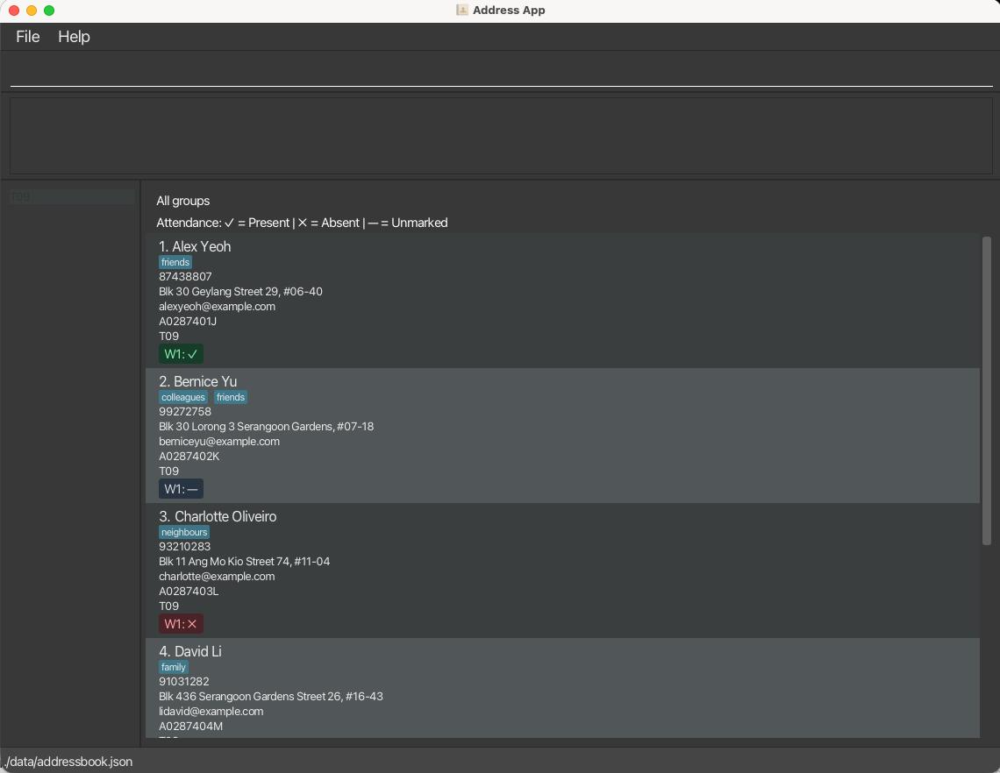

Roster is a **desktop application for NUS teaching assistants to manage students and attendance across multiple tutorial groups**. It is optimized for fast, keyboard-driven use through a Command Line Interface (CLI), while retaining the convenience of a Graphical User Interface (GUI).

* Table of Contents
{:toc}

--------------------------------------------------------------------------------------------------------------------

## Quick start

1. Ensure that Java `25` is installed on your computer. Run `java -version` in your terminal to check the version. 
   **Mac users:** Ensure you have the precise JDK version prescribed [here](https://se-education.org/guides/tutorials/javaInstallationMac.html).

1. Download the latest `.jar` file from the [Roster releases page](https://github.com/AY2627S1-CS2103T-F12-4/tp/releases).

1. Copy the file to an empty, writable folder you want to use as Roster's _home folder_. Roster creates its data, preferences and log files there.

1. Open a terminal, `cd` to the folder containing the JAR file, and run `java -jar "roster.jar"`. 
   A GUI similar to the one below should appear in a few seconds. Roster includes sample data on its first launch. 
   

1. Type a command in the command box and press Enter to execute it. For example, type **`help`** and press Enter to open the help window.

1. Try this typical attendance workflow:

   * `init grp/T09` : Creates tutorial group `T09`.
   * `add n/Alex Tan e/alex.tan@example.com m/A0123456X grp/T09` : Adds Alex Tan to `T09`.
   * `session grp/T09 w/5 d/2026-09-15` : Creates the week 5 session for `T09`.
   * `list grp/T09` : Shows the students in `T09` and makes it the active group.
   * `mark 1 w/5 s/present` : Marks the first displayed student present for week 5.

1. Refer to the [Features](#features) section for full details of each command.

--------------------------------------------------------------------------------------------------------------------

## Understanding Roster

### Tutorial groups and sessions

Every student belongs to exactly one tutorial group. Create a group with `init` before adding students or sessions to it.

A session records that a tutorial group met during a particular teaching week and on a particular date. A group can have at most one session per teaching week.

### Attendance states

For each session in a student's tutorial group, their attendance is one of three states:

* **Present (`✓`)**: The student has been marked present.
* **Absent (`✗`)**: The student has been marked absent.
* **Unmarked (`—`)**: No attendance has been recorded yet. Unmarked is kept separate from absent so unfinished attendance is not mistaken for a confirmed absence.

Creating a session does not automatically mark any student. A student added after sessions have been created is also unmarked for those earlier sessions.

Roster does not yet support returning a recorded status to unmarked. You can, however, replace `present` with `absent`, or vice versa, by running `mark` again.

### Displayed list and active group

* `list` shows every student and clears the active group.
* `list grp/GROUP` shows one group's students and makes that group active.
* `find` searches every group and clears the active group.
* Students are listed by matriculation number in ascending order.
* `INDEX` always refers to the list currently displayed. The same student may have a different index after `list`, `list grp/GROUP`, or `find`.

--------------------------------------------------------------------------------------------------------------------

## Features

**:information_source: Notes about command formats:** 

* Words in `UPPER_CASE` are parameters that you must replace with your own values. 
  For example, replace `GROUP` in `init grp/GROUP` with a group code such as `T09`.

* Items in square brackets are optional. 
  For example, `list [grp/GROUP]` can be used as either `list` or `list grp/T09`.

* Prefixed parameters can be given in any order. 
  For example, both `session grp/T09 w/5 d/2026-09-15` and `session d/2026-09-15 grp/T09 w/5` are valid.

* A prefix marks the start of a parameter. Values containing `/` are accepted where explicitly supported, such as relationship abbreviations in names and CSV file paths.

* Unless a command states otherwise, each parameter may appear only once.

* `INDEX` must be a positive integer and always refers to the currently displayed list.

* If a command fails, Roster does not create, change, or delete any data, and the displayed list remains unchanged.

* If you are using a PDF version of this guide, take care when copying commands that span multiple lines, as spaces around line breaks may be omitted.

### Parameter rules

Parameter | Accepted value
----------|---------------
`grp/GROUP` | One or two letters followed by two digits, e.g. `T09` or `TG01`. Surrounding spaces are removed and letters are converted to uppercase.
`n/NAME` | 1–70 characters. Letters and their accents, spaces, hyphens, apostrophes, full stops and the relationship abbreviations `s/o`, `d/o`, `a/l`, `a/p` (in any letter case). Must begin with a letter and end with a letter, accent or full stop. Examples: `J. Tan`, `Ravi s/o Kumar`. Surrounding spaces are removed, repeated spaces become one space, and letter case is preserved.
`m/MATRIC` | `A`, followed by seven digits and one letter, e.g. `A0287654J`. Surrounding spaces are removed and letters are converted to uppercase.
`e/EMAIL` | A valid email address such as `alex.tan@example.com`. Surrounding spaces are removed and the address is converted to lowercase.
`c/COMMENT` | Text to add to a student's existing comment. 1–200 characters once surrounding spaces are removed and repeated spaces become one space.
`c-/COMMENT` | Text to replace a student's comment with. Same rules as `c/`, except that `c-/` on its own clears the comment.
`t/TAG` | One or more letters or digits, with no spaces or other characters. Repeat `t/` to give a student multiple tags.
`w/WEEK` | A whole number from `1` to `13`, without a leading zero.
`d/DATE` | A real calendar date in `YYYY-MM-DD` format.
`s/STATUS` | `present` or `absent`, case-insensitive.
`INDEX` | A positive integer identifying a student in the currently displayed list.

### Reading command feedback and student rows

The banner below the command box identifies the result of your last action:

* **Ready** appears before you run a command.
* **Command completed**, with a tick, confirms a successful action.
* **Command not run**, with an exclamation mark, explains why a command failed.

The command box also changes its border to indicate success or failure. Starting to type resets that
input highlight; the banner keeps the previous feedback until the next action.

The badge beside the roster heading counts the students currently displayed, so it changes when you
search or switch tutorial groups. Each row shows the student's name, matriculation number, group and
attendance. Scroll vertically to reach additional students or the rest of a tall attendance row.

Click a student row to open their details on the right, or focus the student list, select a row with
the arrow keys and press Enter. The panel opens over the right of the roster, so the command box and the
result of your last command stay visible while it is open. It shows the student's email, tags, comments, and attendance by session.
The attendance percentage counts only marked sessions; unmarked sessions are shown separately.
Scroll inside the panel to read later sessions. Click another row to switch students.

Close the panel with its × button or Escape to see the full roster again. If command
completion suggestions are open, Escape dismisses those first. Opening or closing details does not
change the roster, active group, or displayed row numbers. Successful commands refresh an open panel;
it closes if its student is no longer displayed. After undoing a matriculation-number edit, reopen the
student's row to view their restored details.

### Completing command fields

As you type, the command box suggests command names (e.g. `ad` completes to `add`),
field prefixes supported by the current command,
registered group codes after `grp/`, and `present` or `absent` after `s/`.
For example, `list gr` suggests `grp/`, `list grp/T` suggests matching groups,
and `mark 1 w/3 s/p` suggests `present`.

Completion also covers `comment`, `export`, `undo` and `redo`, the `m/` and `grp/` filters for `find`,
and `all` in place of an index for `mark` and `delete`. For example, `export f` suggests `f/`,
`find m` suggests `m/`, and `mark al` suggests `all`.
For `comment`, choose either `c/` to append or `c-/` to replace or clear; once one is supplied,
the other is not suggested. Phone (`p/`) and address (`a/`) fields are no longer supported or suggested.
Suggestions are suppressed inside quoted export paths so that directory names are preserved.

* Press Up/Down to select a suggestion and Tab to insert it, or click a suggestion.
* Press Escape to dismiss suggestions. Enter always executes the current command.
* Completion replaces the field fragment at the cursor and preserves other fields.
* Group suggestions reflect the currently registered groups, including empty groups.
* `init grp/` accepts a new group code without suggesting existing groups.
* You can continue typing any value normally; existing validation rules still apply.
* Suggestions use prefix matching, without fuzzy matching or spelling correction.

### Viewing help: `help`

Shows a message explaining how to access this User Guide.

Format: `help`

### Creating a tutorial group: `init`

Creates a new, empty tutorial group. The new group becomes the active group and the displayed student list becomes empty.

Format: `init grp/GROUP`

Examples:

* `init grp/T09`
* `init grp/t10` creates group `T10` because group codes are normalized to uppercase.

### Creating a tutorial session: `session`

Creates a session for an existing tutorial group and teaching week. Every student in that group is initially unmarked for the session.

Format: `session grp/GROUP w/WEEK d/DATE`

Examples:

* `session grp/T09 w/5 d/2026-09-15`
* `session d/2026-09-22 grp/t09 w/6`

* A tutorial group can have only one session per teaching week. The date is not part of a session's identity.
* Sessions may be created out of order; attendance is displayed in teaching-week order.
* The date must be a real date, but Roster does not check whether it falls within the specified teaching week.
* Creating a session for an empty group is allowed.
* To correct a session's date, use `editsession`. To remove a session, use `deletesession`.

On success, Roster displays a confirmation such as `Created session: T09 week 5 (2026-09-15)`.

### Editing a tutorial session: `editsession`

Changes the date of an existing session. Students keep their present, absent or unmarked status.

Format: `editsession grp/GROUP w/WEEK d/DATE`

Example: `editsession grp/T09 w/5 d/2026-09-16`

* `grp/` and `w/` identify the existing session; `d/` supplies its new date. All three fields are required,
  may appear in any order, and may each appear only once.
* The group and teaching week remain unchanged. The new date must be a real date in `YYYY-MM-DD` format.
  As with `session`, Roster does not check whether the date falls within the teaching week.
* The command applies to the specified session across its entire group, even when a search hides some students.
  Your current search or group selection stays active.
* A missing session or an unchanged date produces an error without changing data or undo history.
* Use `undo` to restore the previous date. Exported CSV records use the updated date.

On success, Roster displays a confirmation such as
`Updated session: T09 week 5 (2026-09-15 -> 2026-09-16). Attendance is unchanged.`

### Deleting a tutorial session: `deletesession`

Removes a session and every student's attendance records for that session. Students, tutorial groups,
other teaching weeks and other groups' sessions are kept.

Format: `deletesession grp/GROUP w/WEEK`

Example: `deletesession grp/T09 w/5`

* Both fields are required, may appear in any order, and may each appear only once.
* Deletion happens immediately without confirmation. Check the group and week before running the command.
  Use `undo` to restore the session and its attendance records.
* This applies to the entire specified group, including students hidden by a search. Your current search
  or group selection stays active. An empty group can also have its session deleted.
* A missing session produces an error without changing data or undo history.
* The deleted week disappears from students' attendance strips and CSV exports. `mark` cannot record
  attendance for that week until the session is created again.
* Recreating the session with `session` starts everyone as unmarked. Use `undo` instead to recover old marks.

On success, Roster identifies the deleted session and confirms that its attendance records were removed.

### Adding a student: `add`

Adds a student to an existing tutorial group. The student is unmarked for every existing session in that group.

Format: `add n/NAME e/EMAIL m/MATRIC grp/GROUP [t/TAG]...`

Examples:

* `add n/Alex Tan e/alex.tan@example.com m/A0123456X grp/T09`
* `add n/Bernice Yu e/bernice@example.com m/A0287402K grp/T09 t/exchange`
* The tutorial group must already exist.
* Matriculation numbers and email addresses must be unique across all tutorial groups.
* Names do not need to be unique because different students may share a name.
* If the new student is not in the list on screen, for example because another group or a search is shown, Roster switches to the new student's tutorial group so that you can see them.
* Roster scrolls the list to the new student and highlights their card until your next command. The list is sorted by matriculation number, so the new student may appear anywhere in it.

On success, Roster displays a confirmation such as `Added Alex Tan (A0123456X) to tutorial group T09.` When Roster switches to the student's group, the confirmation ends with `Now showing T09.`

### Editing a student: `edit`

Edits the student identified by their index in the currently displayed student list. Only the provided fields are changed; all other details remain unchanged.

Format: `edit INDEX [n/NAME] [e/EMAIL] [m/MATRIC] [grp/GROUP] [t/TAG]...`

Examples:

* `edit 1 n/Alex Tan`
* `edit 2 m/A0123456X e/alex@example.com`
* `edit 3 grp/T10`
* `edit 1 t/class-rep t/needs-follow-up`
* `edit 2 e/bernice@example.com n/Bernice Tan grp/T09`

* `INDEX` must identify a student in the currently displayed student list.
* At least one field must be provided. Parameters may be provided in any order.
* The edited matriculation number and email address must remain unique across all students.
* The specified tutorial group must already exist.
* Each of `n/NAME`, `e/EMAIL`, `m/MATRIC`, and `grp/GROUP` may appear only once.
* Repeating `t/TAG` assigns multiple tags. The provided tags replace all existing tags; use an empty `t/` to remove all tags.
* Attendance cannot be changed using `edit`; use `mark` instead.
* Moving a student to another tutorial group removes their attendance records from the previous group. Sessions in the new group start as unmarked.
* Invalid values, unsupported parameters, and duplicate information are rejected without changing the student.

On success, Roster displays `Edited student:` followed by the updated student details.

### Listing students: `list`

Shows all students or the students of one registered tutorial group, sorted by matriculation number.

Formats:

* `list` — list all students.
* `list grp/GROUP` — list students in one registered tutorial group.

Examples:
* `list` shows every student and clears the active group and any previous search filter.
* `list grp/T09` shows only T09's students and makes T09 the active group.
* `list grp/t09` works too: group codes ignore letter case and surrounding spaces.

Group codes have one or two letters followed by two digits, such as `T09` or `TG01`.
The group must already exist. Listing an empty group is allowed; listing a nonexistent group is an error.

| Situation                  | Feedback                                                                          |
| -------------------------- | --------------------------------------------------------------------------------- |
| All students               | `Listed all 58 students.` (with the actual count)                                 |
| One group                  | `Listed 20 students in T09.` (with the actual count and group)                    |
| Registered but empty group | `Tutorial group T09 has no students yet.`                                         |
| Empty roster               | `No students in Roster. Create a tutorial group and add students to get started.` |
| Unknown group              | `Tutorial group T09 does not exist. Create it first with: init grp/T09`           |

Each student's card shows their name, matriculation number, group and attendance for every session of their group, in teaching-week order:
A green `✓` means present, a red `✗` means absent, and a grey `—` means unmarked.
A student added after a session also shows `—` until their attendance is recorded. Weeks with no session have no cell. The list scrolls when needed.

The group scope is shown above the list. `find` searches across groups and clears the active group.
Deleting a student refreshes the current results without clearing the filter. Adding a student keeps the current results if the new student belongs in them, and otherwise shows the new student's tutorial group.
Student indices are the row numbers currently on screen, so check the displayed list before using `delete`, `edit`,
or `mark`. A successful edit shows all students again in matriculation-number order. Editing a matriculation number
can therefore change row numbers. Moving a student to another group clears their old attendance records; their
attendance strip then uses the new group's sessions.

Only one `grp/` parameter is allowed. Missing group values, invalid codes, repeated parameters and unrelated arguments
are rejected. A rejected list command leaves the data, active group and displayed rows unchanged.

### Navigating tutorial groups

The horizontal tutorial-group strip above the roster starts with **All students**, followed by
registered groups in group-code order. Scroll along the strip if there are more groups than fit on screen.

* Click a group to show its students and attendance, equivalent to `list grp/GROUP`.
* Click **All students** to show the full roster, equivalent to `list`.
* Use Tab to focus the group strip, Left/Right or Up/Down to choose an entry, and Enter to open it.
  Arrow keys alone do not change the displayed roster. Leaving the panel restores the active view's selection.
* The panel follows typed commands: `list` selects **All students**, `list grp/GROUP` selects that group,
  and a successful `find` clears the selection, even when every student happens to match.
* Registered empty groups remain selectable and display the usual empty-group message.
* Navigation preserves unfinished command text and does not change student or attendance records.
* Student indices are refreshed for the newly displayed roster. Check the displayed list before running
  `mark`, `edit` or `delete` with an index.

### Finding students with filters: `find`

Finds students by name, complete matriculation number, tutorial group, or a combination of these fields.
Every supplied filter must match (AND). A search clears the active group and its selection in the group panel.

Format: `find [n/KEYWORD] [m/MATRIC] [grp/GROUP]`

* Supply at least one filter. Each prefix may appear only once, and parameters may be in any order.
* `n/KEYWORD` retains the existing case-insensitive name search. The entire phrase must appear contiguously
  and in the same order: `john tan` matches `John Tan` and `John Tanner`, but not `John Lim` or `Tan John`.
  Accents and punctuation remain significant.
* A name query must contain 1–100 characters after whitespace normalization:
  letters and their accents, spaces, hyphens, apostrophes, full stops,
  or complete `s/o`, `d/o`, `a/l`, `a/p` abbreviations, with at least one letter.
* Surrounding whitespace is ignored, and repeated whitespace is treated as one space. Copied commands
  may use Unicode spaces; line breaks within search arguments are also treated as spaces.
* `m/MATRIC` matches the complete matriculation number. Letter case is ignored; partial numbers are rejected.
* `grp/GROUP` matches one registered tutorial group. Group codes ignore letter case. A nonexistent group
  is an error; a registered but empty group returns no matches.
* Each search considers the complete roster, including after a group view, a previous search, or empty results.
  To restrict a search to a group, supply `grp/GROUP` explicitly.
* Results are sorted by matriculation number in ascending order and show each student's group and attendance.
* A successful search clears the active group even when `grp/GROUP` is supplied, because search results
  may contain only a subset of that group's students.
* Name-only searches retain feedback such as `Found 2 student(s) matching "John".` Other searches report
  the result count and normalized filters, for example `Found 1 student(s) matching filters: n/"John" grp/T09.`
  No-match searches show an empty list. If a name was supplied, Roster may suggest up to three similar
  names with their matriculation numbers. Suggestions respect any matriculation-number and group filters.
  They are hints only: run another search using the suggested name or matriculation number to display
  that student before using an index-based command. For example, `find n/srah` may suggest Sarah.
  If no names are sufficiently similar, Roster asks you to try another name or filter.
* Blank or malformed values, repeated prefixes, unsupported parameters, text before the first prefix,
  and `find` without filters are rejected without changing the displayed list or active group.
* `mark INDEX`, `delete INDEX` and `edit INDEX` use the displayed result indexes. Deleting a student refreshes
  the current results. After an addition, the view follows the behavior described under
  [Adding a student](#adding-a-student-add). A successful edit shows all students again.
* `list` clears the search and shows everyone. `list grp/GROUP` replaces the search with that group's view.
  Searching does not change student records, attendance or saved roster order.

Examples:
* `find n/John` returns `John Doe` and `Johnny Lim`, sorted by matriculation number.
* `find n/john tan` returns `John Tan` and `John Tanner`, sorted by matriculation number.
* `find n/joh` returns names containing `joh`, including `John Tan` and `Johnny Lim`.
* `find m/a0123456x` finds the student with matriculation number `A0123456X`.
* `find grp/T09` finds every student in registered group T09.
* `find n/John grp/T09` finds students in T09 whose names contain `John`.
* `find grp/T09 m/A0123456X n/John` requires all three conditions to match.

### Deleting a student: `delete`

Deletes a student and all of their attendance records. The student's tutorial group and its sessions are kept, even if the group becomes empty.

Format: `delete INDEX`

* `INDEX` refers to the index number in the currently displayed student list.
* The index must be a positive integer within the displayed list.
* Deletion happens immediately without confirmation. Use `undo` to restore the student and attendance records.
* After deletion, the displayed list is refreshed and its indexes are recalculated. Repeating the same command may therefore delete a different student.
* Re-adding the student manually creates a new record whose attendance is unmarked; use `undo` instead to restore
  the original attendance records.

On success, Roster names the deleted student and confirms that their attendance records were also removed.

Examples:

* `list` followed by `delete 2` deletes the second student in the full roster.
* `list grp/T09` followed by `delete 1` deletes the first displayed student in `T09`.
* `find n/Betsy` followed by `delete 1` deletes the first student in the search results.

### Commenting on a student: `comment`

Records a short note about a displayed student, such as what they contributed or what to follow up on.

Formats:

* `comment INDEX c/COMMENT` — add to the student's existing comment.
* `comment INDEX c-/COMMENT` — replace the student's comment.
* `comment INDEX c-/` — clear the student's comment.

Examples:

* `comment 3 c/attentive` sets the comment to `attentive` when the student has none.
* `comment 3 c/asks good questions` then makes it `attentive; asks good questions`.
* `comment 3 c-/needs help with recursion` discards whatever was there and keeps only the new text `needs help with recursion`.
* `comment 3 c-/` removes the comment entirely.

* `INDEX` refers to the currently displayed student list.
* `c/` only ever adds. Repeated notes are joined with `; ` in the order they were added, so a comment reads as a short history.
* `c-/` is the only form that discards an existing note, so a comment is never lost without you having typed it.
* A comment is limited to 200 characters. Adding to a comment fails if the combined text would be longer, and the existing comment is left unchanged.
* Clearing a student who has no comment reports that there was nothing to clear.
* Giving both `c/` and `c-/` in one command is rejected, as is giving neither.
* The displayed list and its indexes stay unchanged after a successful comment.

On success, Roster names the student and shows the resulting comment, so you can check it before moving on.

:bulb: **Tip:**
Because `c/` appends, you can add to a note during the tutorial without retyping what you wrote last week.

:exclamation: **Caution:**
A comment cannot contain a space followed by `c/` or `c-/`, because Roster reads those as the start of another parameter. A note such as `ask about c/c++` is rejected rather than saved incorrectly.

### Deleting all displayed students: `delete all`

Deletes every student in the displayed list, and all of their attendance records. Tutorial groups and their sessions are kept, even if they become empty.

Format: `delete all`

Examples:

* `list grp/T09` followed by `delete all` deletes every student in `T09`, for example at the end of a semester.
* `find n/Tan` followed by `delete all` deletes every student in the search results.

* Only the students on screen are deleted. Students in other groups, or outside the search results, are kept.
* `delete all` while all students are displayed deletes every student. Use `clear` instead to also delete all tutorial groups and sessions.

On success, Roster displays a confirmation such as `Deleted 20 student(s) in the displayed list, including all their attendance records.`

:exclamation: **Caution:**
Deletion happens immediately, with no confirmation. Check the displayed list before running `delete all`. If you delete the wrong students, run `undo` straight away to restore them and their attendance records.

### Marking attendance: `mark`

Records a displayed student as present or absent for one of their tutorial group's sessions.

Format: `mark INDEX w/WEEK s/STATUS`

Examples:

* `mark 3 w/5 s/present`
* `mark 1 s/absent w/6`

* `INDEX` refers to the currently displayed student list.
* The specified teaching week must have a session for that student's tutorial group.
* `STATUS` must be either `present` or `absent`, case-insensitive.
* Marking an already marked student replaces the earlier status and reports the previous value.
* The displayed list and its indexes stay unchanged after a successful mark.
* The updated attendance cell changes to `✓` or `✗`.
* Marking never creates a missing session. When the displayed list contains multiple groups, Roster looks up the teaching week in each selected student's own group.

On success, Roster names the student, status, tutorial group, and teaching week so you can verify the updated record.

:bulb: **Tip:**
Run `list grp/GROUP` before taking attendance so only that tutorial group's students are displayed.

### Marking all displayed students: `mark all`

Records every student in the displayed list as present or absent for the same teaching week.

Format: `mark all w/WEEK s/STATUS`

Examples:

* `list grp/T09` followed by `mark all w/5 s/present` marks every student in T09 present for week 5.
* `mark all w/5 s/absent` while all students are displayed marks every student absent for week 5 of their own group.

* Each student is marked for the session of their own tutorial group, as with `mark`.
* Every displayed student's group must have a session for that week. If any group does not, no student is marked.
* Students who were already marked for that week have their status replaced. The confirmation says how many.
* The displayed list and its indexes stay unchanged.

On success, Roster displays a confirmation such as `Marked 20 student(s) as PRESENT for week 5 in T09.`

:bulb: **Tip:**
To record a class where most students attended, run `mark all w/WEEK s/present` first, then `mark INDEX w/WEEK s/absent` for each absent student.

### Exporting attendance records: `export`

Exports student details and attendance to a new UTF-8 CSV file for use outside Roster.

Format: `export f/FILE_PATH [grp/GROUP]`

Examples:

* `export f/attendance.csv` exports all students, even when a group or search is currently displayed.
* `export f/T09-attendance.csv grp/T09` exports only registered group T09.
* `export grp/t10 f/"reports/T10 attendance.csv"` accepts parameters in either order and paths with spaces.

Rules:

* Supply exactly one non-empty `f/FILE_PATH`. The filename must end in `.csv` (case-insensitive).
* Relative paths are resolved against the folder containing Roster's JAR. Absolute paths are accepted only
  inside that folder or its subfolders. The destination's parent folder must already exist. Paths through
  symbolic links and paths outside this folder are rejected.
* Wrap paths containing spaces in double quotes, especially when a directory name could resemble a command
  parameter. Internal spaces are preserved. For example, `export f/"My reports/T09 attendance.csv"`.
* Supply at most one `grp/GROUP`. Group codes ignore letter case. Unknown groups are rejected.
* Existing files are never replaced. Choose a new filename to export an updated copy.
* The header is always `matric,name,email,group,week,date,attendance`.
* Each student has one row per existing session of their own group. Rows are ordered by matriculation
  number and then teaching week. Dates use `YYYY-MM-DD`.
* Attendance is `present`, `absent`, or `unmarked`. A missing record for an existing session is `unmarked`,
  including when the student was added after that session.
* A student whose group has no sessions appears once, with empty week, date and attendance fields.
  These empty fields do not mean the student was absent.
* An empty roster or registered but empty group produces only the header. Feedback reports zero students
  and zero data rows.
* CSV values containing commas, double quotes or line breaks are quoted, with double quotes escaped.
* Invalid arguments and write failures produce clear errors. The destination is published only after
  the complete CSV has been written, and temporary output is cleaned up if writing fails.
* Exporting leaves roster records, the displayed list and the active group unchanged.

On success, Roster reports the absolute destination and the number of students and CSV data rows exported.
The row count excludes the header and includes the placeholder row for a student with no sessions.

### Undoing the previous change: `undo`

Reverses the most recent successful undoable command.

Format: `undo`

Examples:

* `edit 1 n/Alex Tan` followed by `undo` restores the student's previous name.
* `mark 3 w/5 s/absent` followed by `undo` restores the previous attendance status.
* `add n/Alex Tan e/alex.tan@example.com m/A0123456X grp/T09`
  followed by `undo` removes the newly added student.
* `delete 3` followed by `undo` restores the deleted student and their attendance records.
* `clear` followed by `undo` restores the entire roster.
* `editsession grp/T09 w/5 d/2026-09-16` followed by `undo` restores the previous session date.
* `deletesession grp/T09 w/5` followed by `undo` restores that session and its attendance records.

* Each `undo` reverses one successful data-changing command.
* Multiple `undo` commands reverse earlier changes one at a time.
* `list`, `find`, `export`, `help`, `exit`, invalid commands, and failed commands do not affect the undo history.
* If there are no changes to undo, Roster displays an error without changing any data.
* Undo and redo history are saved with the roster and remain available after closing and reopening Roster.
* Files created by older versions load normally, with no earlier history.
* If the roster data is edited outside Roster and no longer matches its saved history, the history is discarded.
* Saved history includes earlier versions of deleted students and cleared data. Keep the data file private.
* After an undo, a new undoable command discards the states that were undone.
* Press `Ctrl+Z` to undo without typing the command. On macOS, use `Command+Z`.
* When the command box has an undoable text edit, the keyboard shortcut edits the command text instead of
  changing Roster data.

On success, Roster identifies the command that was undone. Restored data is saved automatically and the displayed
list returns to the full roster in matriculation-number order.

### Reapplying an undone change: `redo`

Reapplies the most recently undone data-changing command.

Format: `redo`

Example: `edit 1 n/Alex Tan`, `undo`, then `redo` reapplies the name change.

* Each `redo` reapplies one change; multiple redo commands reapply changes in their original order.
* A new successful data-changing command after undo discards the remaining redo history.
* Read-only commands, invalid commands and failed commands preserve redo history.
* If there is nothing to redo, Roster displays an error without changing data.
* Restored data and the history position are saved automatically, including across restarts.
* As with undo, the displayed list returns to the full roster in matriculation-number order.

### Exiting Roster: `exit`

Exits the application.

Format: `exit`

### Clearing all data: `clear`

Deletes every student, tutorial group, session and attendance record.

Format: `clear`

Clearing happens immediately without confirmation. Use `undo` to restore the cleared roster, including after restarting Roster.

### Saving data

Roster automatically saves changes to its data. You do not need to save manually.

### Editing the data file

Roster data is saved as `data/addressbook.json` inside the folder from which Roster is launched. To keep it beside the JAR, open a terminal in the JAR folder and run `java -jar "roster.jar"`. Close Roster and back up the file before editing it directly.

:exclamation: **Caution:**
If your changes make the data file invalid, Roster starts with an empty roster the next time it runs. The invalid file remains on disk until a successful command causes Roster to save again. Back up the file before editing it. 
Manual edits can also produce unexpected behavior if values do not follow Roster's rules. Edit the data file only if you are confident that you can update it correctly.

--------------------------------------------------------------------------------------------------------------------

## FAQ

**Q**: How do I transfer my data to another computer? 
**A**: Install Roster on the other computer, launch it once, close it, and replace its `data/addressbook.json` file with your saved copy. Use the data folder described in [Saving data](#saving-data).

**Q**: How do I correct a student's details? 
**A**: Use `edit INDEX` followed by the fields to change, for example `edit 1 e/alex.tan@example.com`.

**Q**: How do I switch between tutorial groups? 
**A**: Use `list grp/GROUP`, for example `list grp/T09`. There is no separate switch command.

**Q**: How do I change an attendance record? 
**A**: Run `mark` again for the same student and teaching week with the new status. Roster replaces the earlier status.

--------------------------------------------------------------------------------------------------------------------

## Help window

Running `help` again restores the existing Help window if it is minimized and brings it to the front.

--------------------------------------------------------------------------------------------------------------------

## Command summary

Action | Format, example
-------|----------------
**Help** | `help`
**Create tutorial group** | `init grp/GROUP` e.g. `init grp/T09`
**Create session** | `session grp/GROUP w/WEEK d/DATE` e.g. `session grp/T09 w/5 d/2026-09-15`
**Edit session date** | `editsession grp/GROUP w/WEEK d/DATE` e.g. `editsession grp/T09 w/5 d/2026-09-16`
**Delete session** | `deletesession grp/GROUP w/WEEK` e.g. `deletesession grp/T09 w/5`
**Add student** | `add n/NAME e/EMAIL m/MATRIC grp/GROUP [t/TAG]...` e.g. `add n/Alex Tan e/alex.tan@example.com m/A0123456X grp/T09`
**Edit student** | `edit INDEX [n/NAME] [e/EMAIL] [m/MATRIC] [grp/GROUP] [t/TAG]...` e.g. `edit 1 e/alex.tan@example.com`
**List students** | `list [grp/GROUP]` e.g. `list grp/T09`
**Find students** | `find [n/KEYWORD] [m/MATRIC] [grp/GROUP]` (at least one) e.g. `find n/John Tan grp/T09`
**Delete student** | `delete INDEX` e.g. `delete 3`
**Delete all displayed students** | `delete all`
**Mark attendance** | `mark INDEX w/WEEK s/STATUS` e.g. `mark 3 w/5 s/present`
**Mark all displayed students** | `mark all w/WEEK s/STATUS` e.g. `mark all w/5 s/present`
**Comment on student** | `comment INDEX c/COMMENT` to add, `comment INDEX c-/COMMENT` to replace, `comment INDEX c-/` to clear e.g. `comment 3 c/attentive`
**Export attendance** | `export f/FILE_PATH [grp/GROUP]` e.g. `export f/attendance.csv grp/T09`
**Redo undone change** | `redo`
**Undo previous change** | `undo` or `Ctrl+Z` (`Command+Z` on macOS)
**Exit** | `exit`
**Clear all data** | `clear`
